  

  
  

<h2>👋 About Me </h2>

**Computer Engineering | Data Science & AI | Machine Learning • Deep Learning • Computer Vision • NLP | RAG • LLMs | AI Engineering**

I'm a Computer Engineering student at **ESPRIT**, specializing in **Data Science and Artificial Intelligence**. I build intelligent applications powered by Large Language Models, Retrieval-Augmented Generation and Computer Vision, with a focus on reliable, explainable and privacy-friendly AI.

- 🤖 **AI Engineering**: LLM-powered assistants, RAG pipelines, hybrid search and local LLM deployment
- 🧠 **Machine Learning & Deep Learning**: building and applying models to real-world problems
- 👁️ **Computer Vision**: face detection, face recognition and engagement analysis
- 💬 **NLP**: document processing, semantic search, speech-to-text and text-to-speech
- 📊 **Data Science**: web scraping, data processing and dataset preparation for LLM fine-tuning
- 🐱 **Fun fact**: I love animals, especially cats!

---

## 🛠️ Tech Stack

### 🐍 Language

  

### 🤖 AI, LLMs & RAG

  
  
  
  
  
  
  
  
  

### 🧠 Machine Learning, Deep Learning & Computer Vision

  
  
  
  

### 💬 NLP & Speech

  
  
  
  

### 📊 Data Science & Data Engineering

  
  
  

### 🗄️ Databases

  
  
  
  

### ⚡ AI APIs & Deployment

  
  
  
  
  

---

## 🚀 Featured AI Projects

### 🩺 VITA Agent: AI-Powered 3D Virtual Assistant for Pharmaceutical Training
Academic project in collaboration with ESPRIT and Laboratoire Vitale.
- Built an **LLM-powered** medical quiz module simulating real-world pharmacy negotiation scenarios
- Developed **face detection, face recognition and behavioral analysis** to measure user engagement
- Collected and processed pharmaceutical data through **web scraping** to build datasets for **LLM fine-tuning**
- Created a talking 3D avatar with **text-to-speech** and real-time lip synchronization

`Python` `FastAPI` `Llama 3.1 70B` `Ollama` `RAG` `ChromaDB` `Whisper` `edge-tts` `Computer Vision`

### 📄 Secure RAG Document Assistant (Internship)
AI assistant that answers security compliance questionnaires (GDPR, DORA, ISO 27001) using internal documents.
- Built an end-to-end **RAG pipeline**: document ingestion, chunking, embeddings and vector indexing
- Implemented **hybrid search (vector + BM25)** with reranking for more relevant answers
- Added **grounding validation** and a confidence score to deliver accurate, source-based answers
- Ran a **local LLM** so that no data is sent to the cloud

`Python` `FastAPI` `RAG` `Ollama` `ChromaDB` `Docling` `SQLite`

---

<i>Thanks for visiting! Feel free to explore my repositories or reach out 🐾</i>

